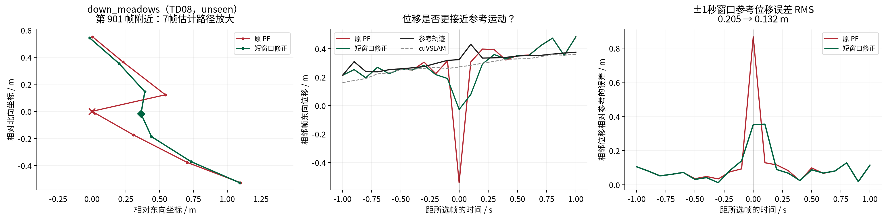

# 短窗口位置修正：实验结果

实验日期：2026-11-11。六条测试轨迹 seed42；其中三条另补 seed43/44，共12次PF记录、22841帧、120组固定设置对照。11项语义测试通过。

原版观测，沿用原地图与预训练权重。默认最多等待5帧（约0.5秒），不改变PF状态或航向，每帧位置最多修正0.5米。修正结果生成后才读取参考轨迹评价。

## 六轨迹主对照：seed42

下表为完整轨迹结果；次数为相邻位移相对cuVSLAM的残差超过0.25米的次数。它是运动一致性指标，不是绝对定位失败次数。

| 轨迹 | PF RMSE/m | 修正RMSE/m | PF参考位移误差RMS/m | 修正参考位移误差RMS/m | PF大残差次数 | 修正大残差次数 |
| --- | ---: | ---: | ---: | ---: | ---: | ---: |
| 2023-11-02-16-00-43_down_meadows | 4.901514 | 4.901300 | 0.081357 | 0.077843 | 15 | 1 |
| figure_8_2023-09-14-12-48-02 | 1.574447 | 1.574118 | 0.090191 | 0.085278 | 46 | 5 |
| turnpike_2023-09-12-12-39-19 | 6.473741 | 6.472305 | 0.421177 | 0.413795 | 161 | 80 |
| turnpike_2023-09-13-18-09-45 | 5.064675 | 5.061686 | 0.191452 | 0.177006 | 203 | 134 |
| warehouse_gupta_skydio_2023-09-13-16-45-20 | 2.220415 | 2.220492 | 0.081342 | 0.078031 | 8 | 0 |
| warehouse_to_fence_2023-09-12-10-19-17 | 2.877468 | 2.877236 | 0.098855 | 0.090512 | 18 | 0 |

六轨迹等权平均ATE RMSE：3.852043 → 3.851190 m。
六轨迹等权平均参考位移误差RMS：0.160729 → 0.153744 m。
大残差次数合计：451 → 220。修改2568/13497帧。

## 多种子复验：相同三条轨迹、seed42/43/44

没有改变窗口、门限、系数或改变量上限。下表是每条轨迹三个种子的均值±样本标准差。其余三条不在多种子复验中，不能将此表称为六轨迹三种子结果。

| 轨迹 | PF RMSE/m | 修正RMSE/m | PF参考位移误差RMS/m | 修正参考位移误差RMS/m | PF大残差次数/种子 | 修正次数/种子 |
| --- | ---: | ---: | ---: | ---: | ---: | ---: |
| 2023-11-02-16-00-43_down_meadows | 4.501281 ± 0.483003 | 4.500884 ± 0.483615 | 0.084341 ± 0.002585 | 0.080263 ± 0.002096 | 26.7 | 10.7 |
| turnpike_2023-09-12-12-39-19 | 6.586759 ± 0.519222 | 6.585054 ± 0.519040 | 0.423278 ± 0.001910 | 0.416003 ± 0.001935 | 170.7 | 85.0 |
| warehouse_to_fence_2023-09-12-10-19-17 | 2.501750 ± 0.325682 | 2.500985 ± 0.326129 | 0.099884 ± 0.001000 | 0.091474 ± 0.001816 | 16.7 | 0.7 |

三轨迹×三种子配对：ATE RMSE等权平均 4.529930 → 4.528974 m；参考位移误差RMS等权平均 0.202501 → 0.195913 m；大残差次数合计 642 → 289。

## 十组设置消融：六轨迹首轮

所有设置均报告，不按测试结果自动挑选方案。window_all仍共享异常降权设置，只是不限制修正启用区域。

| 设置 | ATE RMSE/m | 里程计残差RMS/m | 参考位移误差RMS/m | 大残差次数 | 修改帧数 |
| --- | ---: | ---: | ---: | ---: | ---: |
| identity | 3.852043 | 0.107700 | 0.160729 | 451 | 0 |
| window_all | 3.850019 | 0.080264 | 0.140314 | 208 | 13497 |
| jump_only | 3.851227 | 0.097650 | 0.153874 | 220 | 2301 |
| valley_only | 3.851762 | 0.106854 | 0.160065 | 439 | 452 |
| gated_lag3 | 3.851614 | 0.098880 | 0.154677 | 218 | 1934 |
| gated_lag5 | 3.851190 | 0.097482 | 0.153744 | 220 | 2568 |
| gated_lag10 | 3.850690 | 0.095369 | 0.152292 | 215 | 3839 |
| gated_weak | 3.851697 | 0.100299 | 0.155558 | 255 | 2568 |
| gated_strong | 3.850806 | 0.095927 | 0.152776 | 182 | 2568 |
| mode_centers | 3.854863 | 0.100708 | 0.156313 | 267 | 2568 |

## 现象与解释

- 短窗口主要改善局部运动一致性，绝对地图位置变化很小。不能把这个结果包装成大幅定位精度提升。
- 参考轨迹相邻位移误差也降低，提供了优化目标以外的检查；依然不代表每一帧或所有真实道路条件都改善。
- 普通全时窗口的平滑作用更强，异常触发控制改动范围，但当前未体现出优于全时窗口的指标优势。
- 默认保留PF均值，不直接选簇中心。149个支持不足帧中，88帧均值比两个簇中心都更接近参考位置，122帧优于大权重簇中心。形状异常不能直接当作错误标签。
- TD08第2104帧：平均位置误差1.20米，两个簇中心误差3.58/4.11米，是上述反例。
- 地图偏置、持续错误航向、完全错误道路分支仍无法靠这个位置小修正恢复。
- 参数与方法在本批数据上探索，新增种子是稳定性复验，不是新的独立数据集；尚未验证新路线泛化。

## 数据与图像

- [完整120组指标](results/window_refine.csv)：包括逐轨迹、逐种子和十组设置。
- [方法与运行](WINDOW_REFINE.md)：窗口目标、异常检测与复现实验命令。
- `output/local/window_refine_20261111/`：本地候选、完整轨迹、逐帧诊断与原始图像。

图中红色为原PF，绿色为短窗口修正。左图为第901帧前后共7帧，两个结果使用相同坐标原点；中、右图为前后各1秒。原PF出现反向位移时，该步相对参考运动的误差由0.866降至0.352米。三个完整案例按原PF最大运动残差选帧，不按修正收益选择。图示局部运动改善，整段位置偏差仍存在。
